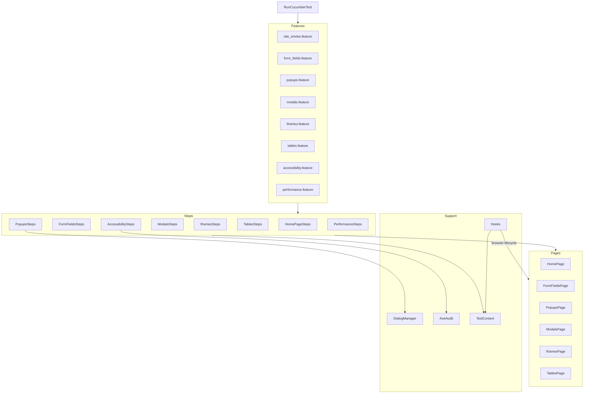

# BDD Playwright Showcase


A GDS-aligned BDD test automation framework demonstrating extensibility,
debugging discipline, accessibility testing, concurrency safety and
documentation. Targets https://practice-automation.com.

## Tech stack

Java 21 + Maven, Cucumber (Gherkin), Playwright, axe-core, AssertJ.

## Quick start

```bash
git clone https://github.com/udaiyan/bdd-playwright-showcase.git
cd bdd-playwright-showcase

mvn verify                                  # full suite, headless
mvn verify -Dheadless=false                 # watch it run
mvn verify -Dcucumber.filter.tags=@smoke
mvn verify -Dcucumber.filter.tags=@accessibility
mvn verify -Dcucumber.filter.tags=@performance
```

HTML report: target/cucumber-reports/cucumber.html

## Architecture



## Coverage

- Functional: smoke, forms, popups, modals, iframes, tables
- Accessibility: WCAG 2.2 AA axe scans, known issues baselined (see ACCESSIBILITY.md)
- Performance: page-load budgets per page

## Key engineering decisions

1. Extensibility: shared DialogManager extracted on second use; row-scoped
   table helpers; centralised BasePage.navigate().
2. Debugging: failure screenshots attached to reports; locator hierarchy
   role/label -> test id -> text; exact matching for data-driven queries.
3. Accessibility: axe-core WCAG 2.2 AA; real violations documented as known
   issues with production guidance (fix / exclude / publish).
4. Concurrency: per-scenario TestContext and browser lifecycle; no shared
   mutable state; safe parallel execution.
5. Documentation: Gherkin as living documentation; comments explain why.

## Extending: add a new page

1. Page object extending BasePage with an open() and locators.
2. Feature file with a @tag and declarative scenarios.
3. Step class injected with TestContext + FrameworkConfig, creating the page
   lazily (PicoContainer builds glue before @Before hooks).

## Known issues

The practice site has real accessibility violations (1 critical, 5 serious).
See ACCESSIBILITY.md and the axe-violations attachments in the Cucumber report.

## CI

GitHub Actions runs the suite on push/PR to main and uploads the Cucumber
report as an artifact. See .github/workflows/test.yml.
